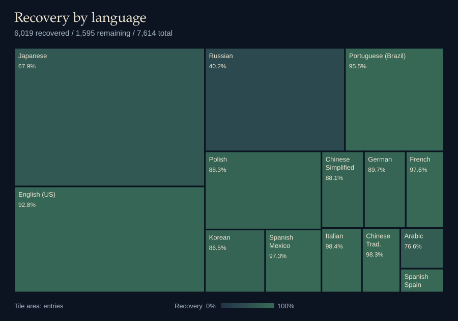

# Names that must not be named

A simple tool for Hogwarts Legacy, using user-submitted character/pet/beast names and checks for restricted words. Try the [live site](https://slothdotexe.github.io/names-that-must-not-be-named/).

Recently, I came across a Reddit thread about Hogwarts Legacy's explicit-name filter catching an innocent name. I couldn't find an explanation online, so I decided to investigate for myself.

In our local game copy, I was able to find `DT_WizardWords` table of hashed word restrictions, however the game can also remotely update this manifest. Given the title's age and infrequent updates, I expect the bundled list to remain a useful reference for the near future. The checker searches all 7,614 original hashes, including those without a recovered word; it cannot establish why a term is restricted or guarantee the game's decision.

For me, it was the hashing process caught my attention. For ordinary ASCII input, the operation works something like this:

1. Lowercase the input.
2. Prepend `phoenix` to it.
3. Encode the result as UTF-8.
4. Compute MD5 and represent the digest as lowercase hexadecimal.

The salt and word variants such as 1337-speak made most of the words difficult to recover, so I turned to Hashcat and its brute-force solutions to discover all the words. That helped me recover most English entries and a majority of the Latin-script entries. There's still plenty of room for help, particularly with international languages. See the [research methodology](research/methodology.md) for the evidence and limits.

I don't expect this project to bring the house down, but this was a fun afternoon research activity spread across a few days, and I hope it helps a few people. 🙂

[](https://slothdotexe.github.io/names-that-must-not-be-named/#recovery)

Type a name into the checker, and results appear automatically after a short pause. English definitions appear when available. The checker searches all 14 language lists together, so a match does not necessarily mean a particular game screen or language will reject the name. The game may also use an updated online list or other validation rules. Recovered words may be offensive and are hidden on the site until revealed.

Matching happens locally. Definitions automatically send flagged text to [Dictionary API](https://dictionaryapi.dev/), including the entire entry when it is itself a match. This site does not put input in its page URL, persistent storage, analytics or application logs. The external provider receives lookup requests; no claim is made about its retention.

## Acknowledgements

Thanks to [Dictionary API](https://dictionaryapi.dev/) for the free, optional English definitions.

## Contribute

Help recover more words using the [contribution guide](research/CONTRIBUTING.md), which records completed searches and work still open. Commit validated recovery data and the refreshed heatmap, not raw Hashcat output.

## Local development

Node.js 24 or newer, npm and Python 3 are required:

```sh
npm ci
npm run dev
```

`npm run data:build` updates the website data and README heatmap from the same sources. Commit `research/recovery.svg` with recovery changes; CI checks that it is current. Other generated files in `public/data/` and `dist/` stay uncommitted.

`npm run build` builds the site. Run `npm test` after data generation, and `npm run test:data` for the Python importer tests.
